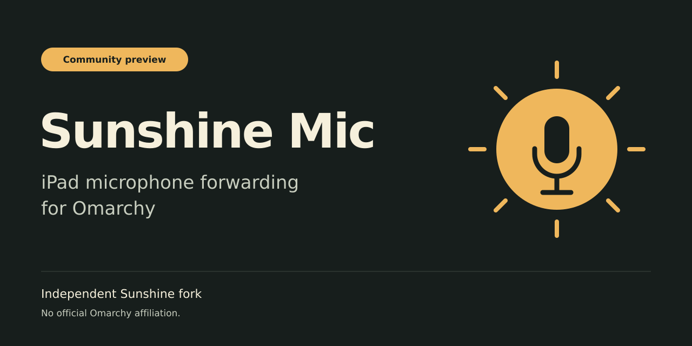

# Sunshine Mic

**iPad microphone forwarding for Omarchy · Community preview · Independent Sunshine fork**

Use your iPad microphone in Linux apps while streaming your Omarchy desktop.
The host input appears as **Moonlight Mic**; choose it in the app that needs your microphone.
This forwards audio, not transcription: no speech models, dictation controls, or automatic default-input switching.

## Install on Omarchy

**[Installation, protected setup, updates and rollback](packaging/omarchy/README.md)**

The preview targets an **Omarchy/Arch x86_64 host**, **PipeWire**, **Tailscale**, and
microphone-capable **VoidLink on iPad**. Stock Moonlight does **not** send microphone audio.
One desktop user and one Tailscale IPv4 iPad peer per host are the preview scope.

**Release qualification is pending.** There is not yet a qualified public preview package or
verified AUR installation. Historical development builds are not release evidence.
Do not replace a working host to help qualify a candidate; use a disposable graphical host.

[Community preview releases](https://github.com/thesubtleforces/sunshine-mic/releases) ·
[Security model](docs/mic_streaming.md) ·
[Troubleshooting](docs/mic_streaming.md) ·
[Build from source](packaging/omarchy/README.md#build) ·
[Fork Issues](https://github.com/thesubtleforces/sunshine-mic/issues)

## Demonstration and compatibility

A consented, redacted iPad demonstration has **not yet been recorded** for the release candidate.
A release must demonstrate VoidLink's microphone enabled and a responding host input meter on
the exact qualified package. Artwork is branding, not product or compatibility evidence.

| Surface | Evidence and preview boundary |
|---|---|
| iPad / VoidLink → PipeWire | Worked in an earlier development deployment; new preview qualification pending |
| Omarchy / Arch x86_64 | Intended preview platform; fresh install, protected reboot and rollback qualification pending |
| Intel VAAPI video | Worked in an earlier development deployment; new preview qualification pending |
| Stock Moonlight microphone | Unsupported: the client does not send microphone audio |
| Other clients, GPUs and architectures | Unverified; inherited Sunshine support is not fork release qualification |

## Security boundary

The microphone transport is **not authenticated or encrypted by Sunshine**. The supported
setup must restrict microphone ingress to the selected peer **on `tailscale0`**, using Tailscale
for the private transport and a dedicated nftables guard before enabling reception. Never expose
the microphone port or the first-run web UI to the public Internet.

Protected setup is explicit opt-in, not an install hook. A startup gate is not continuous tamper
protection: an administrator flushing firewall rules during a session defeats protection until
reapplication. Known alternate LAN-address exclusions are not physical-device authentication.
Another firewall may still deny traffic that this guard accepts.

Setup, reconfiguration and reset require a local keyboard or independent SSH connection:
stopping Sunshine disconnects the streamed desktop. Existing legacy firewall/service overrides
must not be silently adopted. See the [canonical guide](packaging/omarchy/README.md) before changes.

## Support and contributing

Use this fork's [Issues](https://github.com/thesubtleforces/sunshine-mic/issues), not LizardByte's
tracker, for Sunshine Mic reports. Share versions, reproduction steps and redacted diagnostics;
never post credentials, pairing material, private host/tailnet information, or recorded audio.
This is a community preview with no guaranteed response SLA.

[Support](.github/SUPPORT.md) · [Report a vulnerability privately](https://github.com/thesubtleforces/sunshine-mic/security/advisories/new) ·
[Security policy](.github/SECURITY.md) · [Contributing](docs/contributing.md) · [Fork changelog](docs/changelog.md)

Maintainers: [release procedure](packaging/omarchy/RELEASING.md) and
[actual qualification record](packaging/omarchy/QUALIFICATION.md). Preparation is not publication.

The repository intentionally remains a GitHub fork. GitHub excludes forks from ordinary search
by default; use [`sunshine omarchy microphone fork:true`](https://github.com/search?q=sunshine+omarchy+microphone+fork%3Atrue&type=repositories)
or a direct link. Indexing and search-engine ranking are not guaranteed.

## License and attribution

GPL-3.0-only; see [LICENSE](LICENSE) and [NOTICE](NOTICE). This independent community fork
builds on [LizardByte Sunshine](https://github.com/LizardByte/Sunshine) and credits Nova's
microphone-forwarding work. Upstream authors and history remain intact. It is not an official
Omarchy, Sunshine, Moonlight or VoidLink release and implies no endorsement.

[Upstream Sunshine technical documentation](https://docs.lizardbyte.dev/projects/sunshine/latest/)
is background reference, not this fork's installation or security policy. Replacement compatibility
retains `/usr/bin/sunshine`, the existing config directory and canonical user-service identity.
